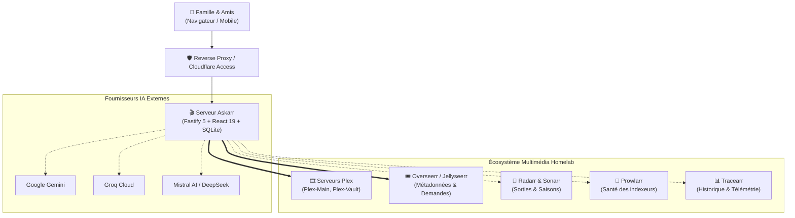

# 🎬 Askarr

### Le copilote conversationnel de cinéma pour Plex et Overseerr

[](package.json)
[](LICENSE)
[](https://github.com/jsuzanne/askarr/pkgs/container/askarr)
[](package.json)
[](test/)
[](package.json)

[English](README.md) | **Français**

Askarr est un assistant conversationnel auto-hébergé conçu pour les passionnés de homelab, leurs familles et leurs amis. Il fait le pont entre le langage naturel et votre écosystème multimédia en transformant la découverte de films, la vérification de disponibilité multi-serveurs Plex et les demandes Overseerr en une expérience d'échange conviviale aux allures de grand cinéma rétro.

Au lieu de parcourir des filtres techniques ou de solliciter directement l'administrateur du serveur, vos proches décrivent simplement ce qu'ils ont envie de regarder. Askarr identifie l'œuvre, vérifie en direct si elle est disponible sur les serveurs Plex auxquels ils ont accès, indique l'état d'avancement des téléchargements et permet de demander les titres manquants en deux clics.

[Pourquoi Askarr ?](#pourquoi-askarr-) • [Démonstration](#démonstration) • [Capacités clés](#capacités-clés) • [Architecture](#intégration-dans-votre-infrastructure) • [Démarrage rapide](#démarrage-rapide) • [Documentation](#documentation--guides) • [Licence](#licence)

---

## Pourquoi Askarr ?

Gérer un serveur multimédia personnel combinant Plex, Overseerr, Radarr et Sonarr offre un confort exceptionnel, mais le partager avec des proches non techniques soulève souvent plusieurs difficultés :

* **Des souvenirs flous plutôt que des titres exacts** : Vos proches ne se souviennent que rarement du titre anglais ou de l'orthographe précise d'une œuvre. Ils cherchent avec des souvenirs comme *"le thriller des années 90 sous la pluie avec Brad Pitt"* ou *"le film de science-fiction avec le trou noir et la bibliothèque"*. Les barres de recherche classiques échouent ; le modèle IA d'Askarr les comprend et les résout immédiatement.
* **La confusion des multi-serveurs** : Si vous administrez plusieurs serveurs Plex (par exemple un serveur familial, un serveur 4K ou une bibliothèque d'archives), les utilisateurs ignorent où se trouve le média. Askarr interroge simultanément vos différents serveurs Plex tout en respectant scrupuleusement les droits de partage accordés à chaque invité sur `plex.tv`.
* **Est-il déjà disponible ou en cours d'arrivée ?** : Les utilisateurs redemandent fréquemment des films déjà en cours de téléchargement ou en attente de sortie VOD/DVD. Askarr détaille clairement l'état réel : *Disponible immédiatement*, *Déjà demandé et prévu en sortie numérique le [Date]*, ou *Disponible à la demande*.
* **Des demandes maîtrisées et sécurisées** : Sans exposer vos interfaces d'administration, Askarr coordonne les demandes validées via l'API Overseerr grâce à un jeton à usage unique protégeant contre les doublons.

Askarr ne remplace ni Plex, ni Overseerr, ni vos applications de gestion : il agit comme un accueil chaleureux et intuitif pour vos spectateurs.

---

## Démonstration

```
Utilisateur :
"Trouve-moi un thriller policier sombre des années 90 avec Morgan Freeman et Brad Pitt."

Askarr :
"Vous pensez sans doute au chef-d'œuvre de David Fincher sorti en 1995 : Se7en ! 🌧️
Deux inspecteurs traquent un tueur en série qui orchestre ses crimes autour des sept péchés capitaux.

Disponibilité :
✅ Disponible immédiatement sur Plex-Main (1080p Remux)
[▶ Ouvrir dans Plex] [▶ Ouvrir sur mobile]"
```

```
Utilisateur :
"On peut regarder Dune deuxième partie ?"

Askarr :
"Paul Atréides s'unit à Chani et aux Fremen pour mener la révolte contre ceux qui ont anéanti sa famille.

Disponibilité :
⏳ Déjà en cours de préparation
Demandé par Alice le 14 octobre. Actuellement surveillé dans Radarr en attente de sortie numérique."
```

```
Utilisateur :
"Est-ce que je peux demander le film Civil War sorti en 2024 ?"

Askarr :
"La traversée sous haute tension d'une Amérique dystopique en pleine guerre civile, par Alex Garland.

Disponibilité :
➕ Non présent dans votre bibliothèque.
[🎟 Confirmer la demande (1 clic)]"
```

> **Aperçu visuel** : Consultez le cahier des charges d'interface dans [docs/ux-spec.md](docs/ux-spec.md) pour découvrir les maquettes de l'interface velours et or, les fiches médias et la Régie d'administration.

---

## Capacités clés

### 1. Recherche conversationnelle sémantique
Recherche par intrigue, réplique marquante, réalisateur, ambiance ou palmarès (César, Oscars, Festival de Cannes). La chaîne de traitement d'Askarr convertit les demandes en langage naturel en requêtes précises vers TMDB et IMDb.

### 2. Vérification multi-serveurs Plex et respect des permissions
Connexion simultanée à plusieurs serveurs Plex Media Server (`Plex-Main`, `Plex-Vault`, etc.). Askarr synchronise les listes de partage `plex.tv` : la disponibilité d'une œuvre est vérifiée strictement sur les serveurs auxquels l'utilisateur connecté a le droit d'accéder.

### 3. Visibilité nette des trois états d'un média
Chaque fiche média présente sans ambiguïté l'un des trois états vérifiés :
- **Disponible immédiatement (`available_now`)** : Liens directs vers Plex Web et l'application mobile (`plex://preplay/...`).
- **Déjà en file d'attente (`already_requested` / `monitored`)** : Indication de l'utilisateur ayant fait la demande, date de mise en attente et date prévisionnelle de sortie VOD/numérique.
- **Disponible à la demande (`canRequestNow`)** : Génération d'un jeton de confirmation pour soumettre la demande proprement dans Overseerr.

### 4. Résilience et routage multi-fournisseurs d'IA
Prise en charge de **Google Gemini**, **Groq Cloud**, **Mistral AI**, **OpenRouter** et **DeepSeek**.
- **Cascade prioritaire** : Sollicite d'abord les modèles économiques ou avec quota offert, puis bascule instantanément vers le fournisseur suivant en cas de dépassement de quota (HTTP 429).
- **Repli direct sans IA (`runDirectSearchFallback`)** : Si tous les fournisseurs d'IA sont temporairement indisponibles, Askarr bascule automatiquement sur une recherche textuelle directe vers TMDB, Plex et Overseerr. L'application reste pleinement fonctionnelle même en cas de coupure des API d'IA externes.

### 5. Régie d'administration dédiée
Un tableau de bord sécurisé permet à l'administrateur de :
- Vérifier la latence, la version et la santé de chaque connecteur multimédia.
- Mettre à jour à chaud les clés d'API, les URLs et les identifiants avec persistance immédiate dans SQLite (aucun redémarrage de conteneur requis).
- Suivre la consommation de jetons IA et le taux de succès du cache.
- Consulter le journal d'audit complet des modifications et des demandes.

### 6. Sécurité Zero Trust et fonctionnement en réseau local
- **Production** : Validation cryptographique des assertions JWT Cloudflare Access (`Cf-Access-Jwt-Assertion`) via les clés publiques JWKS.
- **Réseau local** : Mode de secours administrateur sur le LAN (`ALLOW_LAN_ADMIN_FALLBACK=true`) pour une mise en service immédiate sans nom de domaine externe.
- **Protection des secrets** : Les jetons et clés d'API sont masqués par empreinte SHA-256 dans toutes les réponses d'API.

---

## Intégration dans votre infrastructure

Askarr s'intercale entre vos utilisateurs et vos services existants :



### Matrice des connecteurs

| Service | Rôle dans Askarr | Statut | Comportement en son absence |
| :--- | :--- | :--- | :--- |
| **Plex Media Server** | Vérification de bibliothèque et lecture | **Obligatoire** | Impossible de vérifier la présence d'un titre ou de générer des liens de lecture. |
| **Overseerr / Jellyseerr** | Résolution métadonnées et demandes | **Obligatoire** | Impossible de rechercher des métadonnées ou d'enregistrer des demandes. |
| **Fournisseur IA** | Analyse des requêtes en langage naturel | **Obligatoire** *(≥1)* | L'application active automatiquement le repli de recherche textuelle directe. |
| **Radarr** | Suivi des dates de sortie cinéma et VOD | **Optionnel** | Overseerr fournit l'état de la demande ; les dates de sortie détaillées sont omises. |
| **Sonarr** | Suivi granulaire des saisons de séries | **Optionnel** | Les séries sont suivies au niveau global via Overseerr. |
| **Prowlarr** | Diagnostic de santé des indexeurs | **Optionnel** | L'état des indexeurs est simplement omis de la Régie Admin. |
| **Tracearr** | Historique de lecture Plex et flux actifs | **Optionnel** | Les recommandations s'appuient sur les tendances générales TMDB. |
| **Cloudflare Access** | Authentification Zero Trust SSO | **Optionnel** | Authentification via le mode LAN local ou par en-tête de développement. |
| **Discord** | Notifications par webhook | **Optionnel** | Les alertes de demande sont conservées uniquement dans la base locale. |
| **Google SMTP** | Envoi de billets d'invitation VIP par email | **Optionnel** | L'administrateur partage manuellement les liens d'accès avec ses proches. |

Pour le détail complet de chaque connecteur, consultez le [Guide des intégrations](docs/integrations.md).

---

## Démarrage rapide

La méthode recommandée pour déployer Askarr est Docker Compose.

### 1. Fichier `docker-compose.yml` minimal

```yaml
services:
  askarr:
    image: ghcr.io/jsuzanne/askarr:latest
    container_name: askarr
    restart: unless-stopped
    ports:
      - "4880:4880"
    environment:
      - NODE_ENV=production
      - PORT=4880
      - SQLITE_DB_PATH=/app/data/askarr.db
      - ADMIN_EMAILS=admin@votredomaine.com
      - ALLOW_LAN_ADMIN_FALLBACK=true
      - PLEX_SERVERS=Plex-Main|http://192.168.1.50:32400
      - PLEX_TOKEN=votre_jeton_plex
      - OVERSEERR_BASE_URL=http://192.168.1.60:5055
      - OVERSEERR_API_KEY=votre_cle_overseerr
      - GEMINI_API_KEY=votre_cle_gemini
    volumes:
      - ./data:/app/data
```

### 2. Démarrer le conteneur

```bash
docker compose up -d
```

Ouvrez `http://localhost:4880` dans votre navigateur. En vous connectant depuis votre réseau local, vous êtes automatiquement reconnu en tant qu'administrateur et pouvez accéder à la **Régie** pour affiner vos paramètres.

> 📖 **Guide complet d'installation** : Pour compiler depuis les sources, installer sous Node.js natif ou configurer un tunnel Cloudflare, consultez le [Guide de démarrage rapide](docs/quickstart.md).

---

## Configuration & Administration

Askarr s'appuie sur une configuration à deux niveaux :

1. **Initialisation (`.env`)** : Port réseau, chemin de la base de données, adresse email de l'administrateur principal et connecteurs de base.
2. **Régie d'administration (Interface Web)** : Tous les paramètres de connecteurs, le choix des modèles d'IA, les clés d'API et les notifications peuvent être ajustés à chaud dans l'interface. Les modifications sont enregistrées dans la base SQLite locale (`askarr.db`) et prennent effet immédiatement sans redémarrer le conteneur.

### Masquage des identifiants
Askarr ne renvoie jamais de jetons ou de clés d'API en clair à travers ses endpoints d'administration. Les secrets sont masqués par une empreinte cryptographique SHA-256 (`sha256:abc12...`), protégeant vos données sensibles même lors d'une démonstration d'écran.

---

## Ce qu'Askarr n'est pas

Afin de poser des attentes réalistes :

- **Askarr n'est pas un lecteur ni un serveur de streaming** : Il n'héberge, ne transcode ni ne diffuse aucun fichier vidéo. Il redirige les utilisateurs vers leurs applications officielles Plex.
- **Askarr n'est pas un outil de téléchargement direct** : Il ne télécharge aucun fichier torrent ou Usenet par lui-même. Il transmet les demandes vérifiées à Overseerr, qui pilote ensuite Radarr et Sonarr.
- **Askarr ne contourne pas les règles du serveur** : Les demandes sont soumises aux quotas et autorisations configurés dans votre instance Overseerr.
- **Askarr ne propose pas de visionnage synchronisé** : Le thème de grand cinéma est une identité graphique et narrative pour l'interface de discussion, pas un salon de visionnage partagé en direct.
- **Askarr ne garantit pas la pérennité des offres gratuites d'IA** : Les quotas et conditions des fournisseurs tiers (Gemini, Groq, etc.) sont définis par ces derniers. Askarr assure la bascule automatique, mais vous restez responsable de la gestion de vos clés.

---

## Documentation & Guides

Retrouvez les guides détaillés dans le dossier `docs/` :

- 🚀 [Guide de démarrage rapide & déploiement](docs/quickstart.md) — Installation étape par étape sous Docker et Node.js.
- 🔌 [Matrice des intégrations & connecteurs](docs/integrations.md) — Référence complète des 10 services connectables.
- 🤖 [Fournisseurs d'IA & stratégies de routage](docs/ai-providers.md) — Configuration multi-LLM, bascule automatique et repli sans IA.
- 🛡️ [Sécurité, rôles & Cloudflare Access](docs/security.md) — Authentification Zero Trust, gestion des accès et protection des secrets.
- 📋 [Journal des modifications](CHANGELOG.md) — Historique des versions, nouveautés et correctifs.

---

## Communauté & Contributions

Les contributions, signalements de bugs et retours d'expérience sont les bienvenus !

- **Signalement de bugs** : Si vous rencontrez un dysfonctionnement sur un connecteur, vérifiez les tickets existants et ouvrez une issue sur GitHub.
- **Pull Requests** : Pour toute proposition de code, assurez-vous que les tests Vitest passent (`npm test`) et que le typage est valide (`npm run typecheck`).
- **Échanges** : Partagez vos configurations de homelab et vos idées d'amélioration avec la communauté.

---

## Licence

Askarr est un logiciel libre et open-source publié sous licence [GNU Affero General Public License v3.0 (AGPLv3)](LICENSE).

Cette licence copyleft garantit qu'Askarr demeure libre et ouvert pour tous, en exigeant que toute modification ou amélioration apportée au logiciel soit repartagée avec la communauté, y compris lorsqu'il est exploité sous forme de service sur un réseau.
