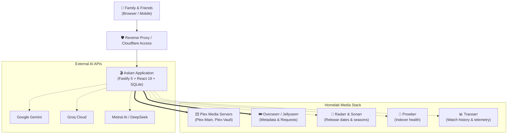

# 🎬 Askarr

### The Conversational Cinema Assistant for Plex & Overseerr

[](package.json)
[](LICENSE)
[](https://github.com/jsuzanne/askarr/pkgs/container/askarr)
[](package.json)
[](test/)
[](package.json)

**English** | [Français](README.fr.md)

Askarr is a self-hosted conversational assistant designed for homelabs, media enthusiasts, and their invited family and friends. It bridges the gap between natural human conversation and your media automation stack by turning complex media discovery, multi-server Plex availability checks, and Overseerr requests into an elegant cinema chat experience.

Instead of navigating technical search filters or messaging the server administrator directly, users simply describe what they feel like watching. Askarr identifies the title, verifies whether it is already playable on the Plex servers they are allowed to access, reports its download status, and allows requesting missing media in two clicks.

[Why Askarr?](#why-askarr) • [See It in Action](#see-it-in-action) • [Key Capabilities](#key-capabilities) • [Architecture](#how-it-fits-into-your-setup) • [Quick Start](#quick-start) • [Documentation](#documentation--guides) • [License](#license)

---

## Why Askarr?

Running a self-hosted media ecosystem with Plex, Overseerr, Radarr, and Sonarr is powerful, but sharing it with family and friends often introduces friction:

* **Vague memories instead of exact titles**: Non-technical family members rarely remember exact English release titles. They search with memories like *"that 90s thriller in the rain with Brad Pitt"* or *"the sci-fi movie with the black hole and books"*. Standard search bars fail; Askarr's conversational LLM resolves them instantly.
* **Multi-server confusion**: If you run multiple Plex servers (such as a primary server, a 4K server, or an archival library), users don't know where a title lives. Askarr inspects all configured Plex servers simultaneously, respecting each user's specific Plex sharing permissions.
* **Is it ready or is it coming?**: Users frequently re-request movies that are already downloading or awaiting digital VOD release. Askarr clearly explains current state: *Available now on Plex*, *Already requested and scheduled for digital release on [Date]*, or *Available to request now*.
* **Safe, scoped requests**: Rather than granting direct administrative or unmonitored access to backend services, Askarr coordinates verified two-step requests through Overseerr with anti-race tokens.

Askarr does not replace Plex, Overseerr, or your `*arr` applications—it serves as the warm, conversational front desk that welcomes your viewers.

---

## See It in Action

```
User:
"Find me a tense 90s detective thriller with Morgan Freeman and Brad Pitt."

Askarr:
"Ah, you're thinking of David Fincher's 1995 masterpiece, Se7en! 🌧️
Two homicide detectives track a serial killer who uses the seven deadly sins as his modus operandi.

Status:
✅ Available now on Plex-Main (1080p Remux)
[▶ Open in Plex] [▶ Open in Mobile App]"
```

```
User:
"Can we watch Dune Part Two?"

Askarr:
"Paul Atreides unites with Chani and the Fremen while seeking revenge against the conspirators who destroyed his family.

Status:
⏳ Already in Progress
Requested by Alice on Oct 14. Currently queued in Radarr awaiting digital release."
```

```
User:
"Can I request the 2024 film Civil War?"

Askarr:
"Alex Garland's adrenaline-fueled journey across a dystopian future America.

Status:
➕ Not yet in your library.
[🎟 Confirm Request (1-Click)]"
```

> **Visual Interface**: See the [Screenshot Gallery Brief](docs/ux-spec.md) for preview captures of the velvet-and-gold retro cinema interface, media cards, and the administrative Régie.

---

## Key Capabilities

### 1. Conversational Semantic Search
Search by plot points, quotes, directors, moods, or festival awards (Oscars, Cannes). Askarr's AI pipeline translates conversational queries into structured TMDB/IMDb lookups, eliminating search friction.

### 2. Multi-Server Plex Verification & Permission Scoping
Connects to multiple Plex Media Servers (`Plex-Main`, `Plex-Vault`, etc.). Crucially, Askarr synchronizes with `plex.tv` sharing lists: media availability is verified strictly against the servers the logged-in user has permission to access.

### 3. Clear Three-State Media Visibility
Every media card accurately displays one of three deterministic states:
- **Available Now (`available_now`)**: Instant playback links to Plex Web and native mobile apps (`plex://preplay/...`).
- **Already in Queue (`already_requested` / `monitored`)**: Shows who requested the title, when it was queued, and estimated digital VOD/home release dates.
- **Available to Request (`canRequestNow`)**: Generates a two-step confirmation token to submit the request through Overseerr cleanly.

### 4. Resilient Multi-Provider AI Routing
Supports **Google Gemini**, **Groq Cloud**, **Mistral AI**, **OpenRouter**, and **DeepSeek**.
- **Cascade Free First**: Leverages cost-effective/free tier models first, immediately falling back to alternative providers on HTTP 429 rate limits.
- **Direct Search Fallback**: If all AI providers are exhausted or unreachable, Askarr automatically falls back to deterministic keyword search via TMDB and Plex/Overseerr. The app never crashes when external AI APIs go down.

### 5. Dedicated Administration: The Régie
Administrators access a protected management dashboard to:
- Test latency, connectivity, and versions of all media connectors.
- Override API keys, endpoints, and server mappings at runtime with persistence in SQLite (no container restart needed).
- Monitor AI token consumption and cache hit ratios.
- Inspect real-time audit logs of all configuration changes and requests.

### 6. Zero-Trust Security & Safe Homelab Defaults
- **Production**: Native verification of Cloudflare Access JWT assertions (`Cf-Access-Jwt-Assertion`) against Cloudflare JWKS.
- **Local Network**: Built-in LAN Admin Fallback (`ALLOW_LAN_ADMIN_FALLBACK=true`) for seamless home deployment without external DNS.
- **Credential Protection**: All sensitive tokens and API keys are SHA-256 masked in API responses.

---

## How It Fits into Your Setup

Askarr sits between your users and your self-hosted infrastructure:



### Connector Matrix

| Service | Role | Status | Behavior if Absent |
| :--- | :--- | :--- | :--- |
| **Plex Media Server** | Library check & play links | **Mandatory** | Cannot verify media presence or generate watch links. |
| **Overseerr / Jellyseerr** | Metadata resolution & requests | **Mandatory** | Cannot search metadata or submit media requests. |
| **AI Provider** | Natural language intent parsing | **Mandatory** *(≥1)* | App engages offline direct keyword search fallback. |
| **Radarr** | Movie release date tracking | **Optional** | Overseerr provides request status; detailed release dates omitted. |
| **Sonarr** | Season-level TV tracking | **Optional** | Shows tracked at series level via Overseerr. |
| **Prowlarr** | Indexer diagnostic monitoring | **Optional** | Indexer health metrics omitted from Admin Régie. |
| **Tracearr** | Plex playback history & live streams | **Optional** | Recommendations use generic TMDB trending data. |
| **Cloudflare Access** | Zero Trust SSO authentication | **Optional** | Local LAN fallback or dev header authentication used. |
| **Discord** | Webhook notifications | **Optional** | Request notifications stored in local database only. |
| **Google SMTP** | VIP invitation email delivery | **Optional** | Invitations must be shared manually by administrator. |

For detailed connector instructions, see the [Integrations Guide](docs/integrations.md).

---

## Quick Start

The fastest way to deploy Askarr is with Docker Compose.

### 1. Minimal `docker-compose.yml`

```yaml
services:
  askarr:
    image: ghcr.io/jsuzanne/askarr:latest
    container_name: askarr
    restart: unless-stopped
    ports:
      - "4880:4880"
    environment:
      - NODE_ENV=production
      - PORT=4880
      - SQLITE_DB_PATH=/app/data/askarr.db
      - ADMIN_EMAILS=admin@yourdomain.com
      - ALLOW_LAN_ADMIN_FALLBACK=true
      - PLEX_SERVERS=Plex-Main|http://192.168.1.50:32400
      - PLEX_TOKEN=your_plex_token
      - OVERSEERR_BASE_URL=http://192.168.1.60:5055
      - OVERSEERR_API_KEY=your_overseerr_key
      - GEMINI_API_KEY=your_gemini_api_key
    volumes:
      - ./data:/app/data
```

### 2. Launch Container

```bash
docker compose up -d
```

Open `http://localhost:4880` in your browser. If accessing from your local LAN, you are automatically recognized as the administrator and can access the **Régie** to fine-tune your settings.

> 📖 **Full Installation Guide**: For building from source, Node.js installation, Cloudflare Tunnel configuration, and troubleshooting, read the [Quick Start Guide](docs/quickstart.md).

---

## Configuration & Administration

Askarr follows a dual-layer configuration strategy:

1. **Bootstrap (`.env`)**: Initial server ports, database path, primary administrator email, and baseline connector credentials.
2. **Runtime Régie (Admin UI)**: All connector settings, model choices, API keys, and notification parameters can be modified on the fly in the web interface. Changes are saved to SQLite (`askarr.db`) and take effect immediately without restarting the service.

### Credential Protection
Askarr never returns raw API keys or Plex tokens over the API. Values are masked with cryptographic SHA-256 hashes (`sha256:abc12...`), ensuring passwords and tokens remain secure even during live administrative demos or screen shares.

---

## What Askarr Is Not

To set accurate expectations:

- **Askarr is not a media player or streamer**: It does not host, transcode, or stream video files. It directs users to their official Plex client apps.
- **Askarr is not a direct downloader**: It does not download torrents or Usenet files directly. It submits verified requests to Overseerr, which coordinates with Radarr and Sonarr.
- **Askarr does not bypass server rules**: User requests are bound by the permissions and quotas configured in your Overseerr instance.
- **Askarr does not offer synchronized group viewing**: The retro cinema theme is an artistic conversational interface, not a shared Watch Party or virtual theater.
- **Askarr cannot guarantee third-party AI free tiers**: Providers (Gemini, Groq, etc.) set their own quotas and availability. Askarr provides automatic failover, but users are responsible for their API quotas.

---

## Documentation & Guides

Comprehensive guides are available in the repository:

- 🚀 [Quick Start & Deployment Guide](docs/quickstart.md) — Step-by-step Docker and bare-metal setup.
- 🔌 [Integrations & Connectors Matrix](docs/integrations.md) — Complete parameter reference for all 10 services.
- 🤖 [AI Providers & Routing Strategy](docs/ai-providers.md) — Multi-LLM setup, cascade failovers, and offline direct fallback.
- 🛡️ [Security, RBAC & Cloudflare Access](docs/security.md) — Zero Trust authentication, permission scoping, and secret masking.
- 📋 [Changelog](CHANGELOG.md) — Version history, recent features, and fixes.

---

## Community & Contributing

Contributions, bug reports, and suggestions are warmly welcomed!

- **Issue Tracker**: If you spot an issue or connector bug, please check existing reports and open an issue on GitHub.
- **Pull Requests**: For code improvements, ensure existing Vitest suites pass (`npm test`) and types validate (`npm run typecheck`).
- **Discussions**: Share your homelab setup and feedback with other community members.

---

## License

Askarr is free and open-source software licensed under the [GNU Affero General Public License v3.0 (AGPLv3)](LICENSE).

This copyleft license ensures that Askarr remains free for everyone, requiring that any modifications or improvements made to the software are contributed back to the community, including when served over a network.
