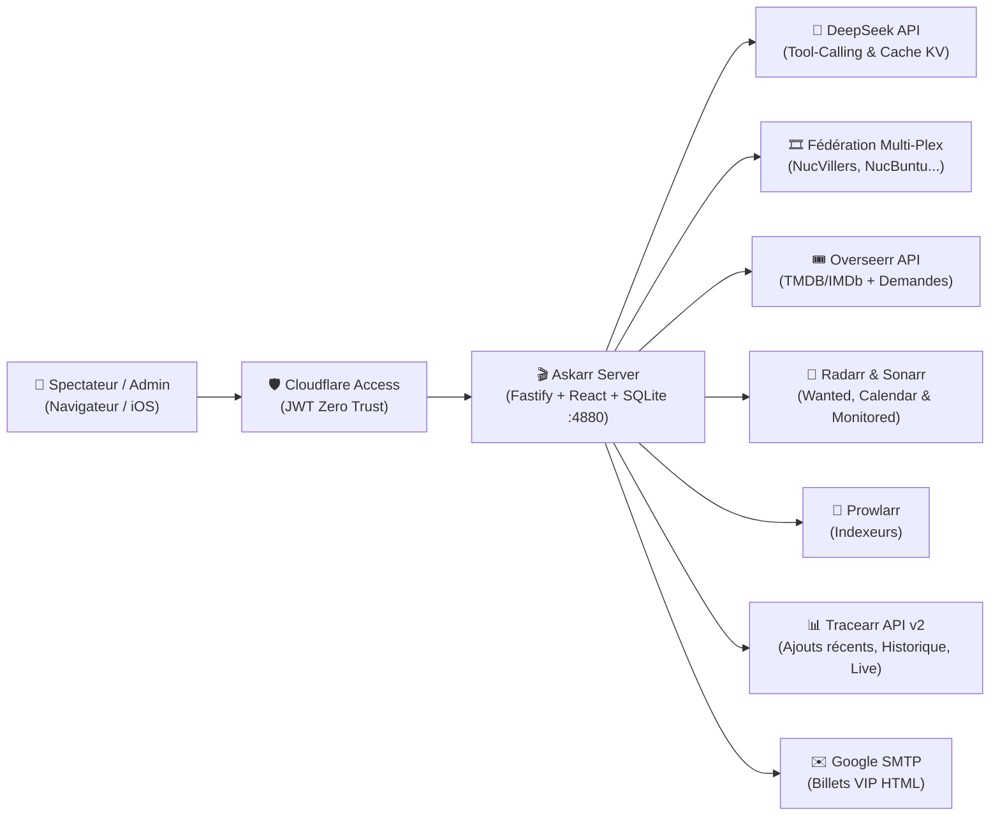

# 🎬 Askarr — Grand Cinéma & Séries


**Askarr** est une salle de cinéma virtuelle et un copilote conversationnel IA conçu pour fédérer plusieurs serveurs **Plex Media Server**, **Overseerr**, **Radarr**, **Sonarr**, **Prowlarr**, **Tracearr**, **Cloudflare Zero Trust Access** et **Google SMTP**.

Il permet aux membres de la famille et aux amis de chercher des films ou séries en langage naturel, de savoir immédiatement s'ils sont **disponibles sur Plex**, **déjà en liste d'attente** (avec date de demande et date de sortie VOD/DVD estimée), ou **demandables en 2 clics**, tout en offrant à l'administrateur une **Régie Admin** complète.

👉 Consulter le [**Journal des modifications (`CHANGELOG.md`)**](./CHANGELOG.md).

---

## 🏗️ Architecture & Écosystème



---

## ✨ Fonctionnalités Principales

### 1. 🍿 Salle Ciné, Recherche Conversationnelle & Routeur Multi-LLM (Gratuit + DeepSeek)
- **Routeur Multi-LLM Intelligent (4 LLM Gratuits + DeepSeek)** : support natif de **Google Gemini** (`gemini-2.5-flash`), **Groq Cloud LPU** (`llama-3.3-70b-versatile`), **Mistral AI** (`mistral-small-latest`), **OpenRouter `:free`** et **DeepSeek** (`deepseek-chat`) avec 3 modes (**Cascade Prioritaire Gratuit $\rightarrow$ Secours**, **Load-Balancing Round-Robin**, **Manuel**) et basculement automatique en cas de quota `HTTP 429`.
- **Recherche en langage naturel** : par titre, réalisateur, acteur, année, souvenir d'intrigue ou palmarès (Festival de Cannes, César, Oscars).
- **Fiches Distributeur enrichies** : affiche officielle, notes **IMDb** et **TMDB**, synopsis complet en français, dates de sortie cinéma et VOD/DVD, et **nom de l'utilisateur Overseerr ayant demandé le film** (ou mention d'ajout automatique par liste).
- **Zéro hallucination de disponibilité** : l'IA s'appuie exclusivement sur les preuves temps réel renvoyées par les connecteurs (`MediaEvidence`).

### 2. 🚦 Visibilité claire des 3 États d'un Film ou d'une Série
Pour chaque titre recherché, Askarr croise **Plex**, **Overseerr** et **Radarr/Sonarr** pour indiquer clairement son état :
1. **✅ Disponible immédiatement sur Plex (`available_now`)** :
   - Indique sur quelle(s) salle(s) Plex (`NucVillers`, `NucBuntu`...) le média est présent et si l'utilisateur connecté y a accès.
   - Boutons de lecture directe vers **Plex Web** (`app.plex.tv`) sur ordinateur et vers l'**application native Plex iOS** (`plex://preplay/...`) sur iPhone/iPad.
2. **⏳ Déjà dans la liste d'attente (`monitored_waiting_release` / `monitored_searching` / `already_requested`)** :
   - Détecte les films demandés via Overseerr **ainsi que** les films ajoutés automatiquement dans Radarr (listes, suivi automatique).
   - Affiche la **date exacte de demande / mise en attente** (`requestedAt` / `added`) et la **date de sortie VOD/DVD estimée** (ex. +4 mois après la sortie cinéma si la date digitale officielle n'est pas encore publiée).
3. **➕ Non listé — Demandable maintenant (`canRequestNow`)** :
   - Si le titre n'est ni sur Plex ni dans la file d'attente Radarr/Overseerr, Askarr propose un **bouton de confirmation en 2 clics** qui crée la demande Overseerr et active la surveillance (`monitored=true`) dans Radarr/Sonarr.

### 3. 📊 Intégration Tracearr API v2 (Nouveautés, Historique & Live)
- **Derniers ajouts Plex** : consultation des derniers films et épisodes ajoutés sur chaque serveur Plex (`NucVillers`, `NucBuntu`, etc.).
- **Historique de visionnage & Streams actifs** : réponses directes aux questions sur les films récemment vus ou les lectures en cours.

### 4. 🎟️ Annuaire Plex.tv, Cloudflare Zero Trust & Billets VIP par Email
- Synchronisation de l'annuaire des amis partagés sur `plex.tv` avec leurs accès serveurs respectifs.
- Ajout/retrait en 1 clic dans les groupes ou policies **Cloudflare Access** avec journal d'audit et **rollback SQLite**.
- Envoi automatique de **Billets d'Invitation VIP** au design Grand Cinéma via **Google SMTP**.

### 5. ⚙️ Régie Admin & Configuration 100 % à Chaud
- **Santé Projecteurs** : test de latence et de version de chaque serveur Plex, Overseerr, Radarr, Sonarr, Prowlarr, Tracearr et Cloudflare Access.
- **Traceur API & Consommation IA** : inspection en temps réel des appels HTTP sortants, du taux de cache KV DeepSeek, du coût en tokens et du solde du compte DeepSeek.
- **Paramètres & Identités** : modification à chaud des URLs, clés API et serveurs Plex (avec auto-découverte `plex.tv`) directement depuis l'interface Web, persistée dans SQLite sans redémarrer le conteneur.

---

## 🚀 Installation & Déploiement

### Option A — Déploiement Docker en Production (Port `4880`)

```bash
mkdir -p /storage/Docker/Askarr/data
cd /storage/Docker/Askarr
cp .env.example .env
# Renseignez vos clés dans .env (ou configurez-les ensuite dans l'interface Régie Admin)
docker compose up -d --build
```

- Application Web : **`http://localhost:4880`**
- Sonde de santé (Liveness + Version) : **`GET http://localhost:4880/api/health/live`**

### Option B — Développement Local

```bash
# 1. Installer les dépendances
npm install

# 2. Copier et configurer l'environnement
cp .env.example .env

# 3. Lancer le serveur backend (port 4880) et le client Vite (port 5173)
npm run dev
npm run dev:client
```

---

## 🔧 Variables d'Environnement Principales (`.env`)

| Variable | Description | Exemple |
| :--- | :--- | :--- |
| `PORT` | Port HTTP du serveur Fastify | `4880` |
| `SQLITE_DB_PATH` | Chemin de la base SQLite persistante | `./data/askarr.db` |
| `PLEX_SERVERS_JSON` | Liste JSON des serveurs Plex (`name`, `baseUrl`, `machineIdentifier`) | `[{"name":"NucVillers","baseUrl":"http://..."}]` |
| `PLEX_TOKEN` | Jeton `X-Plex-Token` administrateur | `xxxx` |
| `OVERSEERR_BASE_URL` / `OVERSEERR_API_KEY` | URL et clé API d'Overseerr | `http://192.168.1.x:5055` |
| `RADARR_BASE_URL` / `RADARR_API_KEY` | URL et clé API de Radarr | `http://192.168.1.x:7878` |
| `SONARR_BASE_URL` / `SONARR_API_KEY` | URL et clé API de Sonarr | `http://192.168.1.x:8989` |
| `PROWLARR_BASE_URL` / `PROWLARR_API_KEY` | URL et clé API de Prowlarr | `http://192.168.1.x:9696` |
| `TRACEARR_BASE_URL` / `TRACEARR_API_KEY` | URL et clé API de Tracearr (`tr_pub_...`) | `http://192.168.1.x:3004` |
| `DEEPSEEK_API_KEY` / `DEEPSEEK_MODEL` | Clé API DeepSeek et modèle (`deepseek-chat`) | `sk-...` |
| `CF_ACCESS_TEAM_DOMAIN` / `CF_ACCESS_AUD` | Domaine et Audience JWT Cloudflare Zero Trust | `https://xxxx.cloudflareaccess.com` |
| `ADMIN_EMAILS` | Liste d'emails administrateurs séparés par virgule | `admin@example.com` |

> **Note** : Toutes ces valeurs peuvent également être configurées ou surchargées à chaud depuis l'interface **Régie Admin → Paramètres & Identités**.

---

## 🏷️ Gestion des Versions & Tests

Askarr suit le versionnage sémantique (`MAJOR.MINOR.PATCH`). Le numéro de version est synchronisé entre [`package.json`](./package.json) et [`src/shared/version.ts`](./src/shared/version.ts), et s'affiche dans l'en-tête de l'application ainsi que sur `/api/health/live`.

```bash
# Incrémenter la version (met à jour package.json, package-lock.json et src/shared/version.ts)
npm run version:patch   # ex: 1.1.0 -> 1.1.1
npm run version:minor   # ex: 1.1.0 -> 1.2.0
npm run version:major   # ex: 1.1.0 -> 2.0.0

# Vérification du typage, exécution des tests et build de production
npm test
npm run build
```
