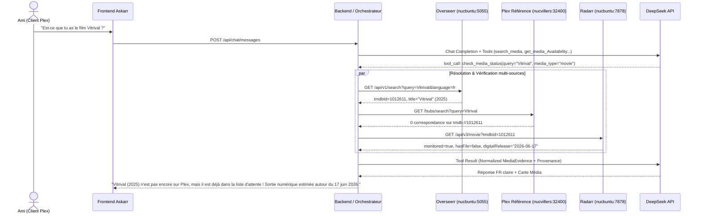
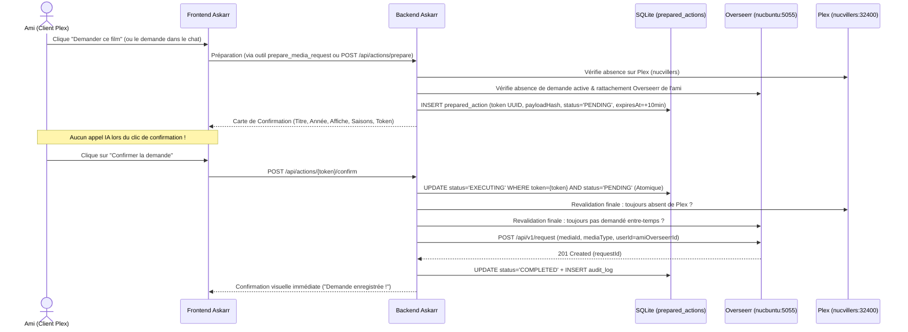

# 03 — Architecture Système & Topologie (Porte G2)

- **Statut :** `READY FOR REVIEW (G2)`
- **Date de mise à jour :** 2026-10-30
- **Périmètre :** Architecture globale du portail **Askarr (Media Copilot)**, découpage modulaire, flux d'exécution, gestion des pannes et topologie de déploiement sur le homelab.

---

## 1. Vue d'ensemble et principes directeurs

**Askarr** est une application web conversationnelle et visuelle conçue en français pour des proches non techniques. Elle agit comme une façade sécurisée et intelligente devant l'écosystème média existant du homelab :

1. **Zéro secret côté navigateur :** Le frontend React 19 ne communique qu'avec le backend Askarr (`/api/*`). Toutes les clés API (`Plex`, `Overseerr`, `Radarr`, `Sonarr`, `Prowlarr`, `Cloudflare`, `DeepSeek`) restent strictement confinées côté serveur.
2. **Vérité terrain par agrégation déterministe :** Le modèle IA (`DeepSeek`) ne devine jamais l'état d'un média. Il invoque des outils serveur typés qui agrègent :
   - **Overseerr (`nucbuntu:5055`)** pour la résolution d'identité bilingue FR/VO (`TMDB` / `TVDB`), l'historique des demandes et la création de demandes.
   - **Plex Media Server de référence (`nucvillers:32400`)** pour la disponibilité réelle sur le stockage NFS Synology partagé (vérification par `Guid` `tmdb://`, `tvdb://`, `imdb://`), contournant ainsi la désynchronisation partielle des bibliothèques observée dans Overseerr en G1.
   - **Radarr (`nucbuntu:7878`) & Sonarr (`nucbuntu:8989`)** pour l'état de surveillance (`monitored`), la présence de fichiers (`hasFile`, `episodeFileCount`), les téléchargements en cours (`queue`) et l'estimation de dates de sortie (`inCinemas`, `digitalRelease`, `physicalRelease`, `nextAiring`).
   - **Prowlarr (`nucbuntu:9696`)** pour le diagnostic de présence sur les indexeurs (avec filtrage strict par catégorie `2000`/`5000` et purge des champs sensibles).
3. **Écritures protégées par jetons serveur à usage unique :** Aucune action d'écriture (demande Overseerr ou modification Cloudflare Access) ne peut être déclenchée directement par le LLM. Un outil de préparation crée un enregistrement `prepared_actions` en base SQLite, et seul un appel HTTP explicite (`POST /api/actions/:token/confirm`) initié par clic utilisateur exécute l'écriture après revalidation serveur.
4. **Sobriété IA & contournement déterministe :** Les actions purement visuelles (clic sur une carte d'ambiguïté, sélection de saisons, clic sur « Confirmer la demande », consultation de « Mes demandes ») appellent directement des routes REST déterministes **sans consommer un seul token DeepSeek**.

---

## 2. Diagramme d'architecture et topologie réseau

```mermaid
flowchart TB
    subgraph Internet["Internet & Bordure Zero Trust"]
        User["Utilisateur (Ami / Admin)<br/>Navigateur Mobile ou Desktop"]
        CFAccess["Cloudflare Access<br/>App: askarr / Policy: allow askarr-user<br/>Injection Cf-Access-Jwt-Assertion"]
        CFAPI["Cloudflare Zero Trust API v4<br/>Groupes & Policies Access"]
        DeepSeek["DeepSeek API<br/>deepseek-chat (Tool Calling)"]
    end

    subgraph Homelab["Homelab LAN (192.168.1.0/24)"]
        subgraph AskarrContainer["Conteneur Docker : askarr (Node 22 LTS)"]
            StaticUI["Frontend SPA<br/>React 19 + TS + Vite + Tailwind v4"]
            AuthMW["Middleware Auth & RBAC<br/>Vérif JWKS Cloudflare + Mapping Overseerr"]
            APIRoutes["Routes REST Déterministes<br/>/api/me, /api/requests, /api/actions/:token/confirm, /api/admin/*"]
            Orchestrator["Moteur d'Orchestration IA<br/>Boucle bornée + Garde-fous + Budget Tokens"]
            Aggregator["Service d'Agrégation & Preuves<br/>Modèle 8 dimensions + Cache court TTL"]
            Connectors["Connecteurs HTTP Résilients<br/>Timeouts + Redaction + Circuit-Breaker"]
            SQLite[("SQLite (WAL)<br/>/data/askarr.db")]
        end

        subgraph Nucvillers["Hôte : nucvillers (192.168.1.163)"]
            PlexRef["Plex #1 : NucVillers (Priorité 1)<br/>:32400 (7 bibliothèques communes)"]
        end

        subgraph Nucbuntu["Hôte : nucbuntu (192.168.1.154)"]
            PlexBuntu["Plex #2 : NucBuntu (Bibliothèques spécialisées)<br/>:32400 (Cinephile, Films 4K, Horror, Musical + communes)"]
            Overseerr["Overseerr v1.35.0<br/>:5055"]
            Radarr["Radarr v6.4.4<br/>:7878"]
            Sonarr["Sonarr v4.0.20<br/>:8989 (->6789)"]
            Prowlarr["Prowlarr v2.7.0<br/>:9696"]
        end

        subgraph Synology["NAS Synology (NFS Partagé)"]
            NFS[("Volumes Médias<br/>Films, Séries & Partages Spécialisés")]
        end
    end

    User -->|HTTPS| CFAccess
    CFAccess -->|Reverse Proxy + JWT| StaticUI
    CFAccess -->|Reverse Proxy + JWT| AuthMW
    AuthMW --> APIRoutes
    AuthMW --> Orchestrator
    Orchestrator -->|OpenAI SDK JSON Tools| DeepSeek
    Orchestrator --> Aggregator
    APIRoutes --> Aggregator
    APIRoutes --> SQLite
    Orchestrator --> SQLite
    Aggregator --> Connectors
    Connectors -->|LAN HTTP :32400 (Priorité 1)| PlexRef
    Connectors -->|LAN HTTP :32400 (Spécialisé / Fallback)| PlexBuntu
    Connectors -->|LAN HTTP :5055| Overseerr
    Connectors -->|LAN HTTP :7878| Radarr
    Connectors -->|LAN HTTP :8989| Sonarr
    Connectors -->|LAN HTTP :9696| Prowlarr
    Connectors -->|HTTPS API v4| CFAPI
    PlexRef -.->|NFS| NFS
    PlexBuntu -.->|NFS| NFS
    Radarr -.->|NFS| NFS
    Sonarr -.->|NFS| NFS
```

---

## 3. Découpage modulaire du conteneur Askarr

Pour garantir une simplicité d'exploitation maximale sur le homelab (à l'image de `transistor` et `potecast` sur `nucvillers`), **Askarr** est empaqueté sous forme d'un **conteneur Docker unique** (`askarr`) servant à la fois les assets statiques compilés du frontend React 19 et l'API backend Fastify.

### 3.1 Couche Frontend (`src/client/`)
- **Stack :** React 19, TypeScript 5.x, Vite 6, Tailwind CSS v4, Lucide Icons.
- **Vues principales :**
  1. **Vue Conversation & Recherche (`/`) :** Fil de discussion en français naturel, cartes de désambiguïsation visuelles (affiche, titre FR + VO, année, synopsis court, badge d'état réel), sélecteur de saisons interactif pour les séries, et cartes de confirmation d'action à 1 clic.
  2. **Vue « Mes demandes » (`/requests`) :** Suivi en temps réel des demandes de l'utilisateur connecté (et de l'ensemble des demandes en vue Admin) avec traduction claire de l'avancement (*Disponible sur Plex*, *En téléchargement*, *En attente de sortie VOD/DVD avec date estimée*, *En recherche*).
  3. **Vue Administration (`/admin`, réservée `admin`) :**
     - Santé des connecteurs (`Plex nucvillers`, `Overseerr`, `Radarr`, `Sonarr`, `Prowlarr`, `Cloudflare`, `DeepSeek`).
     - Gestion des accès amis **Cloudflare Access** (`askarr` / `askarr-user`) avec vérification croisée automatique de la présence du compte Plex dans Overseerr.
     - Consommation IA DeepSeek (tokens d'entrée, cache hits, tokens de sortie, coût estimé, quotas journaliers/mensuels) et journal d'audit.

### 3.2 Couche Backend (`src/server/`)
1. **`auth/` (Authentification & Identité) :**
   - Vérifie cryptographiquement l'en-tête `Cf-Access-Jwt-Assertion` via les clés publiques JWKS de `https://<CF_ACCESS_TEAM_DOMAIN>/cdn-cgi/access/certs` (avec cache mémoire des clés et vérification de l'`aud` `CF_ACCESS_AUD`).
   - Résout le rôle (`admin` si l'e-mail figure dans `ADMIN_EMAILS`, sinon `friend`).
   - Résout et met en cache le profil client correspondant dans Overseerr (`GET /api/v1/user` filtré par e-mail insensible à la casse, vérification `userType: 1` = client Plex).
2. **`connectors/` (Adaptateurs Services Homelab & Cloud) :**
   - `plex.connector.ts` (**Fédération Multi-Serveurs Plex**) : Supporte une liste ordonnée de N serveurs Plex (`PLEX_SERVERS`, par défaut `NucVillers|http://192.168.1.163:32400` en priorité 1 et `NucBuntu|http://192.168.1.154:32400` en priorité 2, extensible à `MacMini`, `EQ12`, etc.). Recense dynamiquement les bibliothèques (`GET /library/sections`) de chaque serveur au démarrage :
     1. Interroge en priorité `NucVillers` (`50 ms` sur le LAN). Si le média est trouvé dans une bibliothèque commune (`Films`, `Séries TV`, `Enfants`, `Films Legacy`, etc.), le connecteur conclut immédiatement sans solliciter `NucBuntu` et indique que le média est disponible sur tous les serveurs Plex.
     2. Si le média n'est pas trouvé sur `NucVillers` (ou si `NucVillers` ne répond pas), le connecteur interroge automatiquement les serveurs suivants (`NucBuntu`, etc.) où résident les bibliothèques spécialisées (`Cinephile`, `Films 4K`, `Horror`, `Musical`). Si le film est trouvé dans une bibliothèque spécifique à un serveur (ex. `Cinephile` sur `NucBuntu`), l'information (`serverName: "NucBuntu"`, `librarySectionTitle: "Cinephile"`, `isExclusiveLibrary: true`) est remontée pour guider précisément l'utilisateur.
   - `overseerr.connector.ts` : Recherche FR/VO (`/api/v1/search`), détails média (`/api/v1/movie/:id`, `/api/v1/tv/:id`), lecture et création de demandes (`/api/v1/request`) attribuées à l'`userId` Overseerr de l'ami connecté.
   - `radarr.connector.ts` : Lookup rapide par `tmdbId` (`GET /api/v3/movie?tmdbId=...`), lecture `queue` et `history`, extraction des dates de sortie (`inCinemas`, `digitalRelease`, `physicalRelease`).
   - `sonarr.connector.ts` : Lookup rapide par `tvdbId` (`GET /api/v3/series?tvdbId=...`), état par saison (`seasons[].statistics`), lecture `queue` et `history`.
   - `prowlarr.connector.ts` : Statut des indexeurs (`/api/v1/indexer`, `/api/v1/indexerstatus`) et recherche filtrée par catégorie (`2000` / `5000`) avec expurgation immédiate de `guid`, `downloadUrl` et `infoUrl`.
   - `cloudflare.connector.ts` : Lecture et mise à jour atomique de la liste d'e-mails autorisés sur la policy `allow askarr-user` (ou le groupe dédié `askarr-user`), avec sauvegarde locale préalable de la révision.
3. **`aggregator/` (Moteur de Vérité à 8 Dimensions) :**
   - Fusionne les réponses des connecteurs dans l'objet normalisé `MediaEvidence` (défini dans [`docs/05-data-model.md`](file:///Users/jsuzanne/Github/askarr/docs/05-data-model.md)) et calcule un résumé déterministe en français ainsi que la liste des sources consultées (`provenance`).
4. **`orchestrator/` (Boucle IA & Garde-fous) :**
   - Pilote `deepseek-chat` avec un contrat de *tool-calling* borné à **3 tours d'outils maximum** par message utilisateur, **1 recherche Prowlarr maximum** par tour, et un budget de tokens strict.
5. **`actions/` (Jeton de Confirmation & Idempotence) :**
   - Génère, valide, verrouille et consomme les jetons `prepared_actions` à usage unique avec TTL de 10 minutes et revalidation de l'état en amont de toute écriture.

---

## 4. Flux de bout en bout (Séquences clés)

### 4.1 Recherche d'un film non présent sur Plex mais déjà programmé dans Radarr
*(Cas d'usage validé avec le propriétaire : ex. film en attente de sortie VOD/DVD)*



### 4.2 Demande d'ajout d'un film ou d'une série (Flux d'écriture sécurisé en 2 temps)



---

## 5. Gestion de la dégradation gracieuse (Pannes partielles)

| Composant indisponible | Comportement d'Askarr | Impact utilisateur |
|---|---|---|
| **Prowlarr (`nucbuntu:9696`) en panne ou lent** | Timeout court (`4 000 ms`). L'agrégateur positionne `indexer_findability: "unknown"`. | Aucun blocage : la disponibilité Plex et les demandes Overseerr fonctionnent normalement. |
| **Radarr ou Sonarr indisponible** | Timeout (`3 000 ms`). L'agrégateur positionne `acquisition_pipeline: "unknown"` et s'appuie sur `Plex` + `Overseerr`. | L'utilisateur voit toujours si le média est sur Plex et peut faire une demande via Overseerr. |
| **Plex (`nucvillers:32400`) indisponible** | Bascule optionnelle en lecture sur `nucbuntu:32400` si configuré en fallback, sinon état `catalog_presence: "unknown"` et blocage préventif des nouvelles écritures pour éviter les doublons. | Message clair : *« La vérification du catalogue Plex est momentanément indisponible. »* |
| **DeepSeek API indisponible ou quota atteint** | Bascule automatique du portail en **Mode Recherche Directe (sans IA)** : la barre de saisie appelle directement l'agrégateur déterministe (`Overseerr` + `Plex` + `Radarr/Sonarr`), affiche les cartes médias et permet de confirmer une demande en 1 clic ! | Continuité de service à 100 % sur les fonctions essentielles (chercher, vérifier, demander, voir ses demandes). |
| **Overseerr indisponible** | La vérification Plex et Radarr/Sonarr reste active via recherche directe, mais la création de nouvelles demandes est temporairement désactivée. | Message clair indiquant que l'enregistrement des demandes est momentanément indisponible. |
