# 05 — Modèle de Données & Modèle de Vérité à 8 Dimensions (Porte G2)

- **Statut :** `READY FOR REVIEW (G2)`
- **Date de mise à jour :** 2026-10-30
- **Périmètre :** Modèle de preuves normalisé à 8 dimensions (`MediaEvidence`) issu des réponses réelles G1 et schéma relationnel SQLite (`Drizzle ORM`).

---

## 1. Le Modèle de Vérité Normalisé à 8 Dimensions (`MediaEvidence`)

Conformément aux observations de la qualification G1, aucun service du homelab ne détient à lui seul toute la vérité :
- **Overseerr (`nucbuntu:5055`)** résout parfaitement les titres en français et en VO via TMDB et connaît les demandes, mais n'a que 3 bibliothèques Plex activées sur 10 et conserve parfois d'anciens `ratingKey`.
- **Fédération Multi-Serveurs Plex (`NucVillers:32400`, `NucBuntu:32400` et serveurs additionnels)** : détient la vérité terrain absolue sur les fichiers réellement présents. `NucVillers` est interrogé en priorité 1 pour les bibliothèques communes (`Films`, `Séries TV`, `Enfants`, `Films Legacy`, `True Crimes`, `Videodivers`), tandis que `NucBuntu` (et tout autre serveur Plex configuré) est interrogé pour les bibliothèques spécialisées (`Cinephile`, `Films 4K`, `Horror`, `Musical`) ou en haute disponibilité si le média est absent de `NucVillers`.
- **Radarr (`nucbuntu:7878`) & Sonarr (`nucbuntu:8989`)** savent si un titre absent de Plex est déjà dans la liste de surveillance (`monitored`), en cours de téléchargement (`queue`), ou en attente de sortie cinéma/VOD/DVD (`inCinemas`, `digitalRelease`, `physicalRelease`).
- **Prowlarr (`nucbuntu:9696`)** permet de vérifier si des releases existent sur les indexeurs lorsque qu'un média surveillé et déjà sorti n'a pas encore été trouvé.

L'agrégateur serveur construit donc pour chaque œuvre candidate un objet immuable **`MediaEvidence`** structuré en **8 dimensions** :

```typescript
export interface MediaEvidence {
  /** 1. Identité canonique & Métadonnées d'aide au choix (issues d'Overseerr / TMDB + Plex + Radarr/Sonarr) */
  identity: {
    mediaType: 'movie' | 'tv';
    tmdbId: number;
    tvdbId: number | null;
    imdbId: string | null;
    titleFr: string;
    originalTitle: string;
    year: number | null;
    overviewFr: string | null;
    posterUrl: string | null;
    genres: string[];                 // ex: ["Science-Fiction", "Aventure", "Drame"]
    runtimeMinutes: number | null;    // Durée en minutes
    directorOrCreator: string | null; // Réalisateur (film) ou Créateur (série)
    topCast: string[];                // 3 à 5 acteurs principaux
    ratings: {
      imdbOrAudienceRating: number | null; // Note IMDb / Audience Plex sur 10 (ex: 8.5)
      tmdbVoteAverage: number | null;      // Note TMDB Overseerr sur 10 (ex: 8.3)
      criticRating: number | null;         // Note critique Plex / Rotten Tomatoes
    };
    releaseDates: {
      inCinemas: string | null;               // ISO date (Sortie salle : Radarr ou TMDB type 3)
      digitalRelease: string | null;          // ISO date (Sortie VOD / numérique : Radarr ou TMDB type 4)
      physicalRelease: string | null;         // ISO date (Sortie DVD / Blu-Ray : Radarr ou TMDB type 5)
      estimatedVodOrDvdDate: string | null;   // Date connue (digital/physical) ou estimée (+4 mois après sortie salle si non publiée)
      isEstimatedDate: boolean;               // true si calculée par heuristique (+120j après cinéma), false si date officielle TMDB/Radarr
      nextAiring: string | null;              // ISO date (prochain épisode Sonarr)
    };
  };

  /** 2. Présence réelle au catalogue Plex multi-serveurs (NucVillers priorité 1 + NucBuntu & serveurs additionnels) */
  catalogPresence: {
    state: 'available_now' | 'partially_available' | 'not_in_catalog' | 'unknown';
    serversQueried: string[]; // ex: ["NucVillers"] ou ["NucVillers", "NucBuntu"]
    matchedItems: Array<{
      serverName: string;          // ex: "NucVillers", "NucBuntu"
      ratingKey: string;
      libraryTitle: string;        // ex: "Films", "Séries TV", "Cinephile", "Films 4K", "Horror", "Musical"
      isSharedAcrossAllServers: boolean; // true pour "Films" / "Séries TV", false pour "Cinephile" / partages dédiés
      title: string;
      year: number | null;
    }>;
  };

  /** 3. État de la demande dans Overseerr (nucbuntu:5055) */
  requestState: {
    state: 'not_requested' | 'pending_approval' | 'approved_processing' | 'available' | 'declined' | 'unknown';
    requestId: number | null;
    requestedAt: string | null;
    requestedByCurrentUser: boolean;
  };

  /** 4. Pipeline d'acquisition dans Radarr / Sonarr (nucbuntu:7878 / :8989) */
  acquisitionPipeline: {
    state:
      | 'not_in_arr'
      | 'unmonitored_no_file'
      | 'monitored_waiting_release' // Dans la liste, en attente de sortie VOD/DVD/Ciné
      | 'monitored_searching'       // Sorti et recherché activement par Radarr/Sonarr
      | 'downloading'               // Actif dans /api/v3/queue
      | 'imported_on_disk'          // hasFile=true
      | 'download_warning_or_error' // Bloqué dans la queue avec warning
      | 'unknown';
    externalServiceId: number | null;
    monitored: boolean | null;
    hasFile: boolean | null;
    estimatedAvailabilityDate: string | null; // Calculé depuis digitalRelease / physicalRelease / inCinemas
    estimatedAvailabilityReason: 'digital_release' | 'physical_release' | 'cinema_release' | 'next_airing' | null;
    queueProgressPercent: number | null;
  };

  /** 5. Couverture par saison et épisode (Séries TV uniquement — Fusion Plex nucvillers + Sonarr + Overseerr) */
  episodeCoverage: {
    totalSeasons: number;
    seasons: Array<{
      seasonNumber: number; // Hors spéciaux (seasonNumber > 0)
      state: 'available_on_plex' | 'partially_available' | 'requested_or_monitored' | 'not_requested';
      plexEpisodeCount: number;
      sonarrEpisodeFileCount: number;
      totalEpisodeCount: number;
      monitoredInSonarr: boolean;
      requestedInOverseerr: boolean;
    }>;
  } | null;

  /** 6. Trouvabilité sur les indexeurs Prowlarr (nucbuntu:9696 — sur demande / diagnostic uniquement) */
  indexerFindability: {
    state: 'not_checked' | 'releases_found' | 'no_release_found' | 'indexers_degraded' | 'unknown';
    matchingReleasesCount: number | null;
    bestSeedersCount: number | null;
    enabledIndexersCount: number | null;
    backoffIndexersCount: number | null;
  };

  /** 7. Actionnabilité immédiate pour l'utilisateur courant */
  actionability: {
    canRequestNow: boolean;
    requestableSeasons: number[]; // Vide pour un film, liste des numéros de saisons demandables pour une série
    blockReason:
      | 'NONE'
      | 'ALREADY_ON_PLEX'
      | 'ALREADY_IN_RADARR_OR_OVERSEERR'
      | 'UNLINKED_PLEX_USER'
      | 'SERVICE_UNAVAILABLE';
    userFriendlySummaryFr: string; // Explication déterministe prête à afficher
  };

  /** 8. Provenance et fraîcheur de la vérification */
  provenance: Array<{
    source: 'overseerr' | 'plex_nucvillers' | 'radarr' | 'sonarr' | 'prowlarr';
    status: 'ok' | 'error' | 'timeout' | 'skipped';
    latencyMs: number;
    checkedAt: string;
  }>;
}
```

### 1.1 Matrice de correspondance des champs réels (G1 → `MediaEvidence`)

| Dimension | Service source | Endpoint qualifié en G1 | Champs réels utilisés |
|---|---|---|---|
| **1. `identity`** | Overseerr + Radarr | `GET /api/v1/search`, `GET /api/v1/tv/:id`, `GET /api/v3/movie?tmdbId=` | `id` (`tmdbId`), `externalIds.tvdbId`, `title`/`name`, `originalTitle`/`originalName`, `releaseDate`, `inCinemas`, `digitalRelease`, `physicalRelease` |
| **2. `catalogPresence`** | Plex (`nucvillers:32400`) | `GET /hubs/search?query=...&includeGuids=1`, `GET /library/metadata/:rk` | `Guid[].id` (`tmdb://...`, `tvdb://...`), `librarySectionTitle` (`Films`, `Séries TV`, etc.), `ratingKey` |
| **3. `requestState`** | Overseerr | `GET /api/v1/movie/:id`, `GET /api/v1/tv/:id`, `GET /api/v1/request` | `mediaInfo.status` (`1..5`), `mediaInfo.requests[].status`, `requestedBy.id` |
| **4. `acquisitionPipeline`** | Radarr / Sonarr | `GET /api/v3/movie?tmdbId=`, `GET /api/v3/queue` | `monitored`, `hasFile`, `status`, `digitalRelease`, `physicalRelease`, `trackedDownloadState`, `size`, `sizeleft` |
| **5. `episodeCoverage`** | Plex (`nucvillers`) + Sonarr + Overseerr | `GET /library/metadata/:rk/children` (Plex), `GET /api/v3/series?tvdbId=` (Sonarr) | Plex `leafCount` par saison + Sonarr `seasons[].statistics.{episodeFileCount, totalEpisodeCount}` + Overseerr `mediaInfo.seasons[].status` |
| **6. `indexerFindability`** | Prowlarr | `GET /api/v1/search?query=...&categories=2000\|5000`, `GET /api/v1/indexerstatus` | Nombre de résultats filtrés, `seeders` max (avec suppression immédiate de `guid`, `downloadUrl`, `infoUrl`) |

---

## 2. Schéma de Base de Données Locale (`SQLite` / `Drizzle ORM`)

Toutes les tables sont stockées dans `/data/askarr.db` (SQLite 3 en mode `WAL`).

### 2.1 Diagramme Entité-Relation

```mermaid
erDiagram
    user_identity_links {
        text cf_email PK "E-mail Cloudflare Access normalisé"
        integer overseerr_user_id "ID utilisateur Overseerr (userType=1)"
        text plex_username "Nom d'utilisateur Plex"
        text role "friend | admin"
        text linked_by "auto_email_match | admin_override"
        text updated_at "ISO Timestamp"
    }

    conversations {
        text id PK "UUID v4"
        text user_email FK "E-mail utilisateur"
        text title "Titre court auto-généré"
        text created_at "ISO Timestamp"
        text updated_at "ISO Timestamp"
    }

    messages {
        text id PK "UUID v4"
        text conversation_id FK "Référence conversations.id"
        text role "user | assistant | tool"
        text content "Texte en français"
        text structured_payload_json "MediaEvidence[] ou ConfirmationCard JSON"
        integer prompt_tokens "Tokens entrée DeepSeek"
        integer completion_tokens "Tokens sortie DeepSeek"
        text created_at "ISO Timestamp"
    }

    prepared_actions {
        text token PK "UUID v4 à usage unique"
        text action_type "OVERSEERR_REQUEST_MOVIE | OVERSEERR_REQUEST_TV | CF_ACCESS_ADD_EMAIL | CF_ACCESS_REMOVE_EMAIL"
        text actor_email "E-mail du créateur"
        integer actor_overseerr_id "ID Overseerr du demandeur"
        text payload_json "Paramètres figés (tmdbId, title, seasons...)"
        text payload_hash "SHA-256 canonique"
        text status "PENDING | EXECUTING | COMPLETED | SUPERSEDED | CANCELLED | EXPIRED | FAILED_RETRYABLE"
        text result_json "Résultat de l'exécution (requestId, etc.)"
        text expires_at "ISO Timestamp (created_at + 10 min)"
        text created_at "ISO Timestamp"
        text updated_at "ISO Timestamp"
    }

    audit_logs {
        integer id PK "Auto-incrément"
        text actor_email "E-mail de l'auteur"
        text actor_role "friend | admin"
        text action_type "Type d'action exécutée"
        text action_token FK "Jeton prepared_actions utilisé"
        text target_summary "Ex: Dune : Deuxième partie (tmdb:693134)"
        text outcome "SUCCESS | SUPERSEDED | FAILED | ROLLBACK"
        text details_redacted_json "Détails sans secrets"
        text created_at "ISO Timestamp"
    }

    cf_policy_revisions {
        integer id PK "Auto-incrément"
        text target_type "policy | group"
        text target_id "ID Cloudflare de la policy/groupe askarr-user"
        text actor_email "Admin ayant déclenché la modification"
        text operation "ADD_EMAIL | REMOVE_EMAIL | ROLLBACK"
        text diff_summary "Ex: +ami@exemple.fr"
        text snapshot_before_json "Payload JSON complet avant écriture"
        text snapshot_after_json "Payload JSON complet après écriture"
        text created_at "ISO Timestamp"
    }

    llm_usage_ledger {
        integer id PK "Auto-incrément"
        text date_day "YYYY-MM-DD"
        text user_email "E-mail de l'utilisateur"
        text model "deepseek-chat"
        integer prompt_tokens "Total prompt tokens"
        integer cache_hit_tokens "prompt_cache_hit_tokens"
        integer cache_miss_tokens "prompt_cache_miss_tokens"
        integer completion_tokens "completion_tokens"
        real estimated_cost_usd "Coût calculé selon tarif configuré"
        text created_at "ISO Timestamp"
    }

    conversations ||--o{ messages : contains
    prepared_actions ||--o| audit_logs : traces
```



---

## 3. Politique d'indexation, de rétention et de migration

1. **Index SQLite créés par défaut :**
   - `idx_conversations_user_updated` sur `conversations(user_email, updated_at DESC)`
   - `idx_messages_conversation_created` sur `messages(conversation_id, created_at ASC)`
   - `idx_prepared_actions_actor_status` sur `prepared_actions(actor_email, status, expires_at)`
   - `idx_llm_usage_day_user` sur `llm_usage_ledger(date_day, user_email)`
   - `idx_audit_logs_created` sur `audit_logs(created_at DESC)`
2. **Rétention et purge automatique :**
   - Les jetons `prepared_actions` au statut `'PENDING'` dont `expires_at < now` passent automatiquement à `'EXPIRED'`.
   - Les conversations de plus de `90 jours` sont purgées automatiquement, tandis que `audit_logs`, `cf_policy_revisions` et `llm_usage_ledger` sont conservés `365 jours`.
