# 09 — Plan d'Implémentation par Jalons Vérifiables (Porte G2)

- **Statut :** `READY FOR REVIEW (G2)`
- **Date de mise à jour :** 2026-10-30
- **Périmètre :** Découpage incrémental de l'implémentation après validation de la porte **G2**, avec critères de sortie et points d'arrêt obligatoires (**G3**, **G4**, **G5**).

---

## 1. Vue d'ensemble de la trajectoire d'implémentation

```mermaid
flowchart LR
    G2["Porte G2 (Actuelle)<br/>Validation Architecture & Contrats"] -->|Validation Humaine| G3_1["Jalon G3.1<br/>Socle TS, SQLite & Auth JWKS"]
    G3_1 --> G3_2["Jalon G3.2<br/>Connecteurs Lecture & Agrégateur 8D"]
    G3_2 --> G3_3["Jalon G3.3<br/>Orchestrateur DeepSeek (Lecture)"]
    G3_3 --> G3_4["Jalon G3.4<br/>UI React 19 FR (Lecture Seule)"]
    G3_4 --> G3["Porte G3 (STOP)<br/>Validation MVP Lecture Seule"]
    G3 -->|Autorisation Écritures| G4_A["Jalon G4-A<br/>Écritures Overseerr + Jetons 1-clic"]
    G4_A --> G4_B["Jalon G4-B<br/>Admin Cloudflare Access + Rollback"]
    G4_B --> G5["Porte G5<br/>Dockerisation Finale & Recette CA-01..15"]
```

---

## 2. Phase G3 — MVP Lecture Seule (Zéro écriture externe)

> [!IMPORTANT]
> Durant toute la phase **G3**, aucun appel `POST`/`PUT`/`DELETE` vers Overseerr ou Cloudflare Access n'est actif. L'objectif est de prouver la fiabilité à 100 % de la compréhension, de la désambiguïsation et du diagnostic en lecture sur le homelab réel.

### Jalon G3.1 — Socle Backend/Frontend, Base SQLite & Authentification Zero Trust
- **Livrables :**
  - Structure monorepo propre (`src/shared/`, `src/server/`, `src/client/`, `tests/`).
  - Base SQLite (`better-sqlite3` + `Drizzle ORM`) avec migrations automatiques et backup pré-migration.
  - Middleware d'authentification Cloudflare Access (`Cf-Access-Jwt-Assertion` via JWKS) + fail-fast en production si `ALLOW_DEV_AUTH_HEADER=true`.
  - Service de liaison d'identité (`email` Cloudflare ↔ `userId` client Plex `userType: 1` dans Overseerr).
  - Logger Pino avec redaction automatique de tous les secrets.
- **Critère de vérification :** `npm run test:security` et `GET /api/me` validés.

### Jalon G3.2 — Connecteurs en Lecture Seule & Agrégateur à 8 Dimensions
- **Livrables :**
  - `plex.connector.ts` pointé sur **`nucvillers` (`http://192.168.1.163:32400`)** avec résolution par `Guid` (`tmdb://`, `tvdb://`, `imdb://`) et détail des saisons (`/children`).
  - `overseerr.connector.ts` (recherche FR/VO RFC 3986, détails film/série, liste des demandes et utilisateurs).
  - `radarr.connector.ts` & `sonarr.connector.ts` (lookup direct `tmdbId`/`tvdbId`, `queue`, `history`, calcul de date de sortie estimée `digitalRelease`/`physicalRelease`/`inCinemas`).
  - `prowlarr.connector.ts` (filtrage strict `categories=2000|5000` et purge immédiate de `guid`, `downloadUrl`, `infoUrl`).
  - `media-aggregator.service.ts` produisant l'objet normalisé `MediaEvidence` (8 dimensions + provenance).
- **Critère de vérification :** 100 % des tests de contrat sur les fixtures réelles anonymisées G1 (`npm run test:contract`) passent au vert.

### Jalon G3.3 — Moteur d'Orchestration DeepSeek & Garde-fous de Coûts (Lecture)
- **Livrables :**
  - Client `deepseek-chat` avec prompt système français à préfixe statique (*Context Caching*), `MAX_TOOL_ROUNDS = 3`, `MAX_PROWLARR_CALLS_PER_TURN = 1`.
  - Outils en lecture seule : `search_and_check_media`, `get_series_seasons_detail`, `diagnose_media_acquisition`, `get_my_requests`.
  - Comptabilisation automatique de chaque appel dans `llm_usage_ledger` (`prompt_tokens`, `prompt_cache_hit_tokens`, `prompt_cache_miss_tokens`, `completion_tokens`) et bascule automatique en **Mode Recherche Directe** si quota atteint.
- **Critère de vérification :** Tests d'orchestration et qualification réelle en lecture sur vos titres tests (*Dune*, *The Enforcer*, *Vitrival*, *One Piece*).

### Jalon G3.4 — Interface React 19 Mobile-First en Français (MVP Lecture)
- **Livrables :**
  - Vue Chat & Recherche rapide en français sans jargon technique.
  - Cartes visuelles de désambiguïsation (`MediaCandidateCard`) avec affiche, titre FR + VO, année, badge d'état réel et date de sortie estimée.
  - Vue « Mes demandes » (`/requests`) enrichie en direct.
  - Vue Admin Santé des connecteurs & Consommation DeepSeek (`/admin`).
- **Point d'arrêt obligatoire :** **Porte G3** — Démonstration du MVP lecture seule et demande d'autorisation humaine explicite avant d'activer G4.

---

## 3. Phase G4 — Écritures Contrôlées, Confirmations à Usage Unique & Audit

### Jalon G4-A — Demandes Overseerr avec Confirmation Serveur à Usage Unique
- **Livrables :**
  - Outil `prepare_media_request` et route `POST /api/actions/prepare` (0 token IA).
  - Sélecteur de saisons interactif (`SeasonPickerModal`) et carte de confirmation (`ActionConfirmationCard`).
  - Route `POST /api/actions/:token/confirm` avec verrouillage SQLite atomique, revalidation pré-écriture sur `Plex nucvillers` + `Overseerr`, gestion anti-course (`SUPERSEDED`), vérification `GET` post-timeout avant tout retry, et enregistrement dans `audit_logs`.
- **Critère de vérification :** Tests d'intégration `T-WRITE-01` à `T-WRITE-04` + test réel contrôlé (Lot 1C) sur un média choisi avec vous.

### Jalon G4-B — Gestion Admin Cloudflare Access (`askarr` / `allow askarr-user`) & Rollback
- **Livrables :**
  - Connecteur d'écriture Cloudflare Access ciblant la policy `allow askarr-user` (ou le groupe associé) de l'application `askarr`.
  - Vérification automatique du rattachement Plex/Overseerr lors de la saisie d'un e-mail ami + gestion des alias (`user_identity_links`).
  - Protection anti-lockout (`ADMIN_EMAILS` non supprimables), sauvegarde systématique avant/après dans `cf_policy_revisions`, et restauration en 1 clic (`POST /api/admin/cloudflare/access/rollback/:id`).
- **Critère de vérification :** Tests `T-WRITE-05` + validation sur l'application Cloudflare Access `askarr`.

---

## 4. Phase G5 — Packaging Docker, Durcissement & Recette Finale
- **Livrables :**
  - `Dockerfile` multi-stage optimisé (Node 22 Alpine, utilisateur non-root `node`, `HEALTHCHECK`).
  - `docker-compose.yml` et `.env.example` documentés pour déploiement immédiat sur `nucvillers` (ou `nucbuntu`).
  - Exécution complète de la matrice de recette sur les 15 critères d'acceptation (`CA-01` à `CA-15`).
