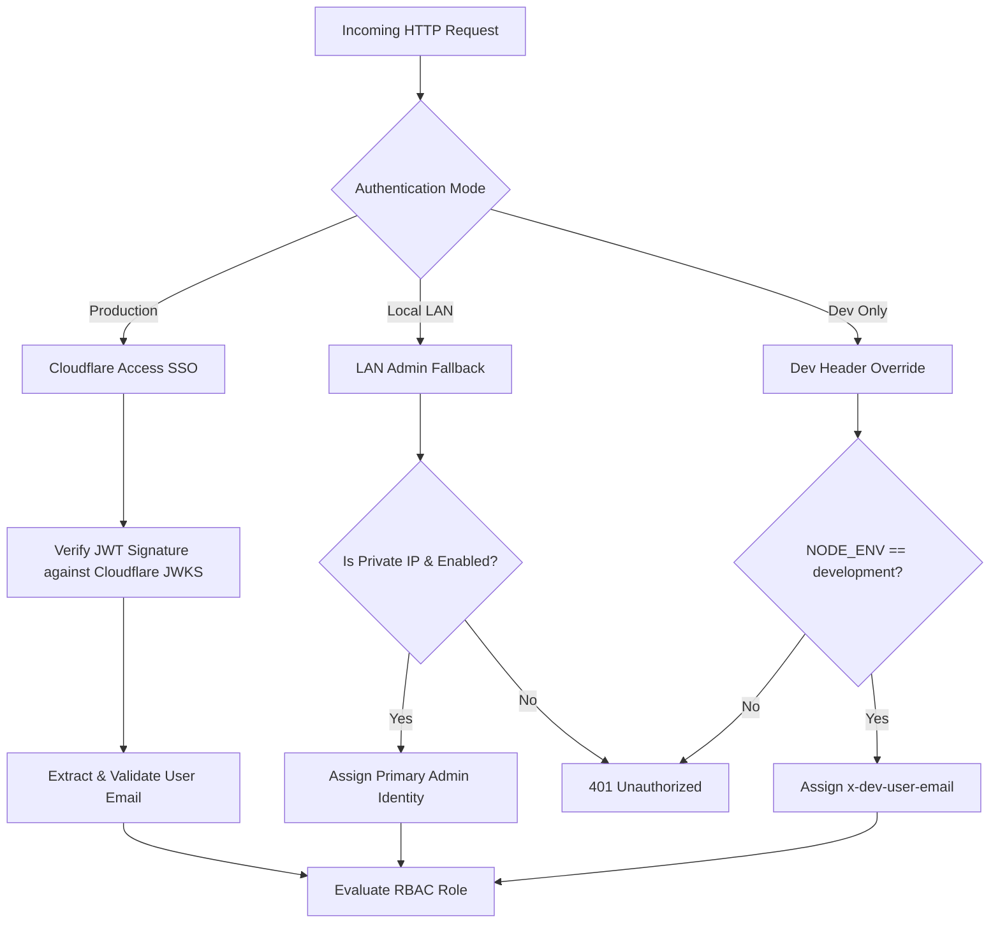
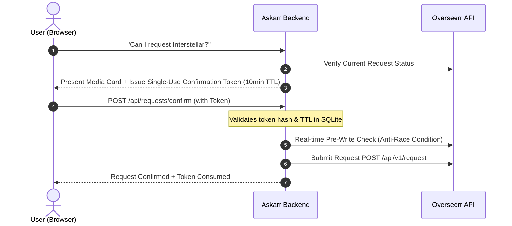

# Security Architecture & Permissions — Askarr

Askarr is designed to be safely exposed to friends and family while protecting sensitive home infrastructure, internal IP addresses, and administrative credentials.

---

## 1. Authentication Models

Askarr decouples identity management from local password stores by supporting zero-trust identity layers alongside local homelab fallbacks.

### 1. Cloudflare Access Zero Trust (Production Recommended)
In production, Askarr is ideally placed behind a Cloudflare Tunnel protected by Cloudflare Access.
- **Headers Verified**: `Cf-Access-Jwt-Assertion` and `Cf-Access-Authenticated-User-Email`.
- **Validation**:
  - The JWT is cryptographically validated using public certificates fetched from `https://<YOUR_TEAM>.cloudflareaccess.com/cdn-cgi/access/certs`.
  - The audience tag (`aud`) must match `CLOUDFLARE_AUD_TAG`.
  - Tokens expiring or forged outside Cloudflare's cryptographic authority are rejected with HTTP 401.

### 2. LAN Admin Fallback (`ALLOW_LAN_ADMIN_FALLBACK=true`)
Designed for homelab setup and local network use without configuring external DNS:
- When enabled, requests originating from private IP ranges (`127.0.0.1`, `::1`, `10.0.0.0/8`, `172.16.0.0/12`, `192.168.0.0/16`) without Cloudflare headers are authenticated as the first administrator listed in `ADMIN_EMAILS`.
- External requests lacking valid credentials are strictly rejected.

### 3. Development Header Override (`ALLOW_DEV_AUTH_HEADER=true`)
- Restricted to `NODE_ENV=development`.
- Allows simulating multiple user personas (e.g., admin vs friend) during UI testing via the `x-dev-user-email` header.

---

## 2. Role-Based Access Control (RBAC)

Askarr categorizes users into two roles:

| Capability | Admin (`admin`) | Friend (`friend`) |
| :--- | :---: | :---: |
| Conversational Chat & Media Search | Yes | Yes |
| Request Missing Titles & Track Status | Yes | Yes |
| Direct Plex Playback Links | Yes | Yes |
| Régie / Admin Settings Management | Yes | No |
| LLM Provider Key & Routing Configuration | Yes | No |
| Media Connector Endpoints & Secrets | Yes | No |
| Send VIP Cinema Ticket Invitations | Yes | No |
| View System Logs & Audit Trail | Yes | No |

- **Admin Determination**: Evaluated by checking if the authenticated email is present in the `ADMIN_EMAILS` environment variable or SQLite configuration.

---

## 3. Library Scoping & Plex Server Isolation

When running multiple Plex servers (e.g., a family server and a restricted 4K or archival server), Askarr ensures strict data isolation:

1. On startup or scheduled sync, Askarr queries `plex.tv/api/users` using the admin token to retrieve the list of friends and their shared server permissions.
2. When a user queries Askarr for a film or show, availability is cross-referenced with `userAllowedServers`.
3. If Title X exists only on `Plex-Vault`, but User Y only has access to `Plex-Family`, Askarr marks Title X as **Unavailable** for User Y and permits them to submit a request through Overseerr.

---

## 4. Two-Step Request Confirmation & Anti-Race Token

To prevent duplicate requests and accidental API hammering, media requests follow an enforced two-step flow:

- **Token Security**: Confirmation tokens are generated using cryptographically secure random bytes, hashed with SHA-256, and limited to a 10-minute time-to-live.
- **Pre-Write Check**: Even with a valid token, Askarr performs a real-time check against Overseerr before writing to ensure another household member has not requested the title in the intervening seconds.

---

## 5. Secret Masking & Audit Trail

- **Zero Plaintext Token Exposure**: All API keys, Plex tokens, and webhook URLs returned by administrative REST endpoints are masked using SHA-256 fingerprint hashes (e.g., `sha256:...`).
- **Audit Logging**: Sensitive configuration mutations in the Régie are logged to an append-only SQLite audit table with timestamps, IP addresses, and user email identities.
